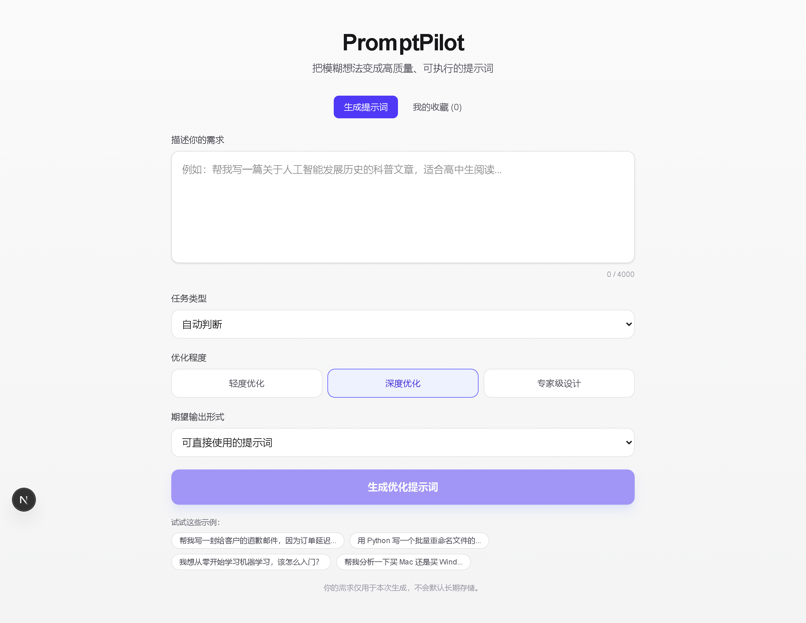
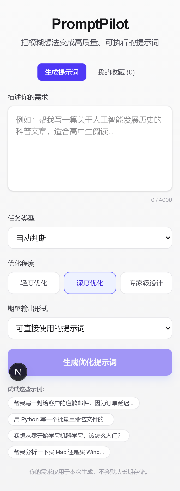

# PromptPilot

[](.github/workflows/ci.yml)
[](LICENSE)
[](https://nextjs.org)
[](https://react.dev)
[](https://www.prisma.io)

把模糊想法变成高质量、可执行的提示词。

PromptPilot 是一个面向普通用户的提示词优化 Web 应用：无需提示词工程知识，只需描述你的需求，系统会自动完成需求分析、结构化生成、六维质量检查与自动修复，并支持版本对比与云端收藏管理。

## 功能特性

- **需求分析与澄清**：自动识别目标、背景、约束与成功标准，关键信息缺失时提出少量针对性问题，可回答或跳过
- **场景化生成策略**：为编程开发、写作创作、学习辅导、分析决策、商业营销、自动化智能体、图像生成等任务类型提供独立优化策略
- **结构化输出**：默认覆盖任务目标、角色视角、执行步骤、约束、输出格式、验收标准等完整结构
- **六维质量检查**：目标清晰度、背景完整度、任务可执行性、约束明确度、输出可用性、验收可验证性，100 分制可解释评分
- **自动修复**：发现问题后自动生成修订版本，并逐条说明修改原因
- **版本管理**：同一需求可多轮优化，支持查看任意两个版本间的差异对比
- **云端收藏**：会话与版本持久化存储，按匿名用户 ID 隔离，支持搜索、编辑、删除、导出
- **模型可切换**：兼容任意 OpenAI 风格接口，通过环境变量配置服务地址、模型名与密钥
- **无密钥降级**：未配置模型密钥时自动进入模拟模式，完整体验全部流程
- **移动端适配**：响应式布局，通过 iPhone 375/320 视口专项测试

## 截图

| 桌面端 | 移动端 |
| --- | --- |
|  |  |

## 技术栈

| 类别 | 选型 |
| --- | --- |
| 框架 | Next.js 16（App Router / Cache Components / Turbopack） |
| 前端 | React 19 + TypeScript + Tailwind CSS 4 |
| 数据库 | Prisma 6（开发 SQLite / 生产 PostgreSQL） |
| 模型层 | 服务端调用，OpenAI 兼容接口（默认 DeepSeek-V3 @ SiliconFlow） |
| 测试 | Vitest（35 项单元测试）+ Playwright 移动端专项测试 |

## 快速开始

### 本地开发

环境要求：Node.js 20.9+（推荐 22 LTS）、npm 10+。

```bash
# 1. 克隆仓库
git clone https://github.com/jinshi678/promptpilot.git
cd promptpilot

# 2. 安装依赖
npm install --legacy-peer-deps

# 3. 配置环境变量
cp .env.example .env

# 4. 初始化数据库（SQLite，零配置）
npx prisma migrate deploy

# 5. 启动开发服务器
npm run dev
```

打开 [http://localhost:3000](http://localhost:3000) 即可使用。

### 模型配置

在 `.env`（或生产环境变量）中配置：

| 变量 | 必填 | 默认值 | 说明 |
| --- | --- | --- | --- |
| `MODEL_API_URL` | 否 | `https://api.siliconflow.cn/v1` | OpenAI 兼容接口地址 |
| `MODEL_NAME` | 否 | `deepseek-ai/DeepSeek-V3` | 模型名称 |
| `MODEL_API_KEY` | 生产必填 | 空 | 模型服务密钥；留空时自动使用模拟模式 |
| `MAX_INPUT_LENGTH` | 否 | `4000` | 输入长度上限（字符） |
| `RATE_LIMIT_PER_MINUTE` | 否 | `20` | 每分钟优化请求上限 |
| `DATABASE_URL` | 是 | `file:./dev.db` | Prisma 连接串 |

密钥仅保存在服务端环境变量中，不会下发到浏览器；接口响应内置密钥泄漏拦截检查。

### Docker 部署

生产环境提供多阶段构建的 Dockerfile 与 docker-compose 编排（app + PostgreSQL 16，容器启动时自动同步数据库结构）：

```bash
cp .env.example .env    # 填入 MODEL_API_KEY，修改 POSTGRES_PASSWORD
docker compose up -d --build
```

详见 [DEPLOY.md](DEPLOY.md)。

## 测试

```bash
npm test                        # 35 项单元测试（模型调用、质检修复、版本 diff 等）
node scripts/mobile-test.mjs    # 移动端专项测试（需先启动 dev 服务器）
```

## 项目结构

```
├── src/
│   ├── app/                  # 页面与 API 路由（optimize / sessions）
│   ├── components/           # UI 组件（输入区、结果工作区、收藏列表等）
│   ├── lib/                  # 模型调用层、质检修复、diff 算法、Prisma 单例
│   │   └── __tests__/        # Vitest 单元测试
│   └── types/                # 类型定义
├── prisma/                   # Schema 与迁移
├── scripts/                  # 移动端专项测试脚本
├── Dockerfile                # 三阶段构建（standalone 输出，非 root 运行）
├── docker-compose.yml        # app + PostgreSQL 编排
└── DEPLOY.md                 # 部署指南
```

## 隐私说明

- 你的需求内容仅用于本次生成，不做长期留存与训练
- 日志不记录用户原始输入内容
- 收藏数据按匿名用户 ID 隔离，可随时删除

## Roadmap

- [ ] 用户账号体系（当前为浏览器匿名 ID）
- [ ] 生产 PostgreSQL 迁移文件（当前容器内使用 db push 同步结构）
- [ ] 提示词导出格式扩展与 i18n

## 许可证

[MIT](LICENSE) © 2026 jinshi678
